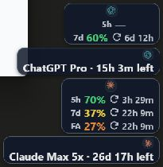

# Win-CodexBar

Win-CodexBar is a native Windows system-tray and floating-overlay app for monitoring AI-provider usage without keeping provider dashboards open. This customized Tauri + React + Rust build is based on CodexBar 0.45.2 and adds Windows-focused subscription visibility, a privacy-safe FloatBar, and reliable X watchlist notifications.



## What this build adds

- Genuine `ChatGPT Pro` and `Claude Max 5x` subscription countdowns when the providers expose authoritative future expiry dates.
- A compact always-on-top FloatBar with the OpenAI mark for ChatGPT, remaining quota, reset countdowns, Claude `FA` quota, and no Pace rows.
- Truthful unavailable values: an unavailable or informational window displays `—` instead of a fabricated percentage.
- Correct quota severity colors independent of used/remaining display mode.
- An X notification panel attached to the tray dashboard for `@thsottiaux`, `@OpenAI`, and `@sama`, with replies/reposts, exact status links, seven-day deduplication, retry/backoff, and visible sanitized errors.
- Privacy filtering: FloatBar account pills show only plan type and genuine subscription countdown—never email, cost, cookies, tokens, or inferred expiry.
- Automatic update installation disabled for this customized build so upstream releases cannot silently overwrite the verified behavior.

## Install on Windows 11

### Recommended: installer

1. Open the [latest release](https://github.com/ljdstechva/Win-CodexBar/releases/latest).
2. Download the Windows x64 installer ending in `x64-setup.exe` and its matching `.sha256` file.
3. In PowerShell, verify the download before running it:

   ```powershell
   $Installer = "C:\Path\To\CodexBar-Desktop_x64-setup.exe"
   (Get-FileHash -Algorithm SHA256 -LiteralPath $Installer).Hash
   Get-Content -LiteralPath "$Installer.sha256"
   ```

   The two SHA-256 values must match.

4. Close any running CodexBar instance, run the installer, and launch **CodexBar** from the Start Menu.
5. Windows SmartScreen may warn because this community build is currently unsigned. Continue only after the checksum matches the release checksum.

The installer adds the WebView2 bootstrapper when Windows needs it. Existing settings are stored at `%APPDATA%\CodexBar\settings.json` and should remain unchanged during an upgrade.

### Portable or same-version upgrade

The release also includes a portable executable ending in `x64-portable.exe` with its own `.sha256` file. It can run without installing.

If Windows already has the same CodexBar version and the installer leaves the older executable in place:

1. Exit CodexBar.
2. Back up `%LOCALAPPDATA%\Programs\CodexBar\codexbar.exe`.
3. Verify the portable executable checksum.
4. Replace the installed `codexbar.exe` with the verified portable executable.
5. Relaunch CodexBar and confirm the installed and portable SHA-256 hashes match.

## Copy-paste prompt for an AI agent

Paste the following into Codex or another trusted local coding agent:

```text
Install the latest verified public release of Win-CodexBar from
https://github.com/ljdstechva/Win-CodexBar on this Windows 11 x64 computer.

Requirements:
1. Use PowerShell and download only from this repository's GitHub Releases page or GitHub Releases API. Do not use mirrors.
2. Select the latest non-draft, non-prerelease release. Download the x64 setup EXE, the x64 portable EXE, and both matching .sha256 files.
3. Verify each file with Get-FileHash -Algorithm SHA256 before executing or copying it. Stop and report if any checksum differs.
4. Before changing anything, record the SHA-256 of %APPDATA%\CodexBar\settings.json if it exists and create a rollback backup of the existing %LOCALAPPDATA%\Programs\CodexBar installation directory.
5. Stop only running CodexBar processes whose executable path is inside that exact installation directory. Do not stop unrelated processes.
6. Run the verified installer and wait for completion. If a same-version installation does not replace codexbar.exe, stop CodexBar and copy the verified portable EXE to %LOCALAPPDATA%\Programs\CodexBar\codexbar.exe instead.
7. Confirm the installed executable's SHA-256 matches the verified portable release asset, confirm ProductVersion is the expected release version, and confirm the settings-file hash is unchanged.
8. Launch the installed app and verify that the CodexBar process remains running and the FloatBar or tray UI appears.
9. For Claude subscription expiry only, if Claude Desktop is locking its cookie database, close Claude Desktop briefly, relaunch/refresh CodexBar once, then restore Claude Desktop. Never print, copy, or expose cookies, tokens, API keys, or account email.
10. Report the installed path, version, final SHA-256, settings-preservation result, rollback location, and any remaining warning. Do not change provider settings unless I explicitly ask.
```

## First run

1. Click the CodexBar tray icon to open the dashboard.
2. Open **Settings → Providers** and enable the providers you use.
3. Configure each provider through its supported login, API key, token account, manual cookie, or browser-cookie import flow.
4. Open **Settings → Display** to enable and configure the FloatBar.

For Claude, briefly close Claude Desktop during CodexBar's first authenticated refresh if the subscription countdown says `expiry unavailable`; Claude Desktop can lock its cookie database. Reopen Claude after CodexBar has loaded the authoritative billing boundary.

## Main custom surfaces

- **Tray dashboard:** provider cards, capacity/reset details, subscription countdowns, refresh/settings actions, and the X notification bell.
- **FloatBar:** native always-on-top overlay showing remaining capacity and optional privacy-safe account pills.
- **X updates:** rolling seven-day unread ledger for the fixed watchlist, with `Check now`, exact post links, and visible failure state.
- **Settings:** five tabs—General, Providers, Display, Advanced, and About.

## Build from source

### Prerequisites

- Windows 11 x64
- Rust stable with the `x86_64-pc-windows-msvc` target
- Microsoft Visual Studio Build Tools with **Desktop development with C++**
- Node.js 20+
- pnpm 10.18.1 (Corepack can install the pinned package-manager version)

### Clone and build the release bundles

```powershell
git clone https://github.com/ljdstechva/Win-CodexBar.git
Set-Location Win-CodexBar
corepack enable
Set-Location apps\desktop-tauri
pnpm install --frozen-lockfile
pnpm exec tauri build
```

Outputs:

- App executable: `target\release\codexbar-desktop-tauri.exe`
- NSIS installer: `target\release\bundle\nsis\CodexBar Desktop_<version>_x64-setup.exe`
- MSI installer: `target\release\bundle\msi\CodexBar Desktop_<version>_x64_en-US.msi`

### Run in development

```powershell
Set-Location apps\desktop-tauri
pnpm run tauri:dev
```

### Verification commands

```powershell
cargo test --manifest-path rust\Cargo.toml
cargo test --manifest-path apps\desktop-tauri\src-tauri\Cargo.toml

Set-Location apps\desktop-tauri
pnpm test
pnpm run build
```

Windows-native testing is required for tray behavior, browser-cookie access, DPAPI, installation, and always-on-top overlay behavior.

## Verified state

The committed QA evidence is in [`artifacts/main-v0.45.2-live-qa`](artifacts/main-v0.45.2-live-qa):

- release and installed executable hashes
- settings-preservation evidence
- authenticated ChatGPT and Claude expiry verification
- live FloatBar, tray, and X-panel screenshots
- automated test/build counts and supervisor approval

The current installer and executable are unsigned. Always verify the published SHA-256 sidecars.

## Privacy

- Provider data stays local except for requests to the provider APIs you explicitly configure.
- Browser-cookie import is opt-in.
- App-managed API keys, manual cookies, and token accounts use the existing secure-file/DPAPI path where available.
- Diagnostics and screenshots must not expose raw cookies, bearer tokens, API keys, account email, or other secrets.
- The FloatBar account pill is restricted to plan type and genuine expiry countdown.

## Upstream and license

- Original project: [steipete/CodexBar](https://github.com/steipete/CodexBar)
- Windows upstream history: [nesszer/Win-CodexBar](https://github.com/nesszer/Win-CodexBar)
- License: MIT; see [LICENSE](LICENSE)

This repository contains a customized Windows build. Upstream updates must be re-ported and re-verified before installation because automatic update replacement is intentionally disabled.
